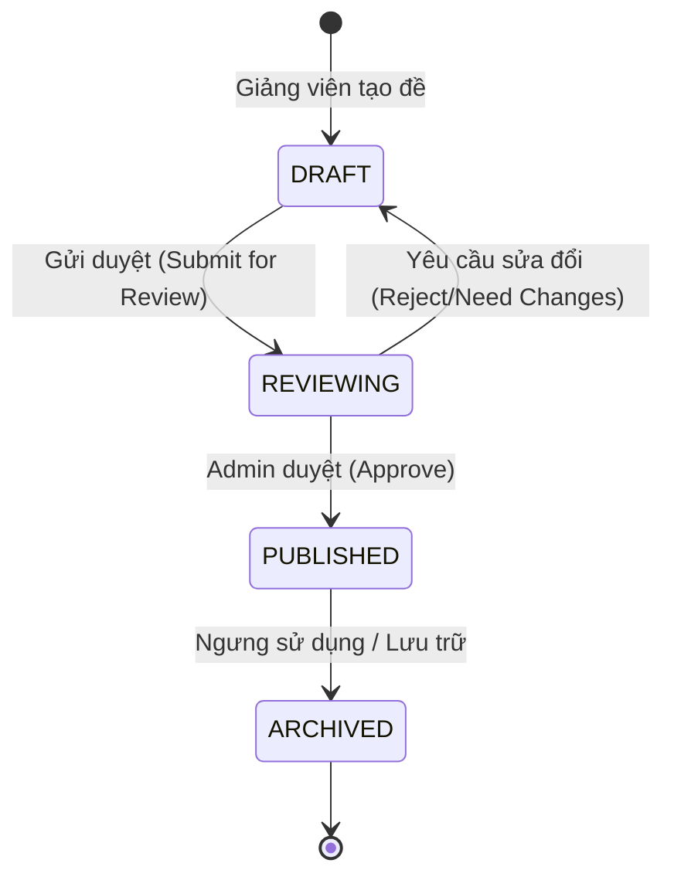
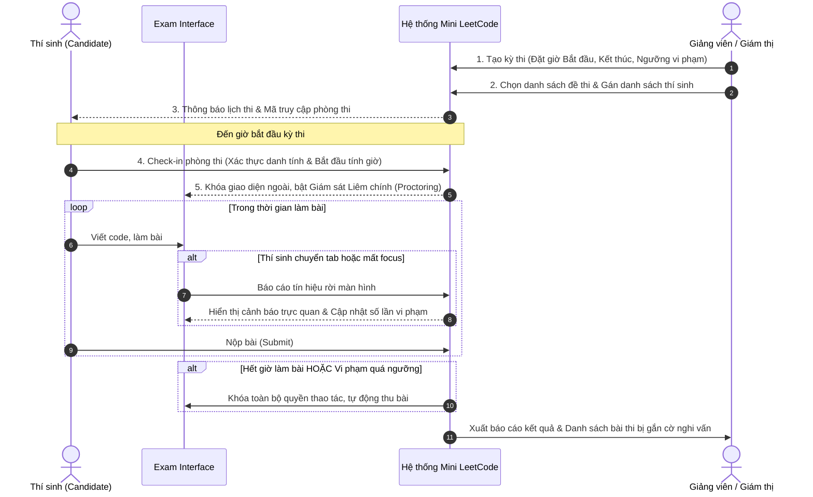

# TÀI LIỆU ĐẶC TẢ NGHIỆP VỤ (BUSINESS REQUIREMENTS DOCUMENT - BRD)
## DỰ ÁN: MINI LEETCODE PLATFORM
**Phiên bản:** 3.0.0 (Tách bạch hoàn toàn tầng Nghiệp vụ & Kỹ thuật)  
**Tác giả:** Lead Technical Product Owner  
**Trạng thái:** Approved for System Architecture & QA Test Scenarios

---

## 1. TỔNG QUAN & MỤC TIÊU SẢN PHẨM (EXECUTIVE SUMMARY)

Mini LeetCode Platform là nền tảng giải quyết 2 bài toán nghiệp vụ song song:
1. **Chế độ Luyện tập Tự do (Practice Mode):** Hỗ trợ lập trình viên rèn luyện tư duy thuật toán, tự do thử nghiệm giải thuật, cung cấp phản hồi nhanh (Fast Feedback Loop) mà không gây áp lực về kiểm soát hành vi.
2. **Chế độ Thi / Kiểm tra Đánh giá (Exam / Contest Mode):** Môi trường đánh giá năng lực lập trình có giám sát liêm chính (Proctoring/Anti-Cheat), bảng xếp hạng thời gian thực (Real-time Leaderboard), quy chế tính điểm chặt chẽ và cơ chế bảo vệ thí sinh trước sự cố đường truyền mạng.

---

## 2. CHÂN DUNG NGƯỜI DÙNG & MA TRẬN PHÂN QUYỀN (ACTORS & PERMISSIONS)

| Vai trò (Actor) | Trách nhiệm chính | Quyền hạn nghiệp vụ |
|---|---|---|
| **Candidate / Student (Thí sinh/Học viên)** | Tham gia giải bài luyện tập hoặc làm bài thi được giao. | - Xem danh mục bài tập công khai.<br>- Chạy thử nghiệm code (Run Code) với testcase công khai.<br>- Nộp bài chính thức (Submit) để nhận kết quả.<br>- Tham gia phòng thi (Exam Room) khi có mã truy cập/được mời.<br>- Xem bảng xếp hạng sau khi kết thúc đợt thi. |
| **Instructor / Author (Giảng viên/Người ra đề)** | Xây dựng ngân hàng đề và tổ chức kỳ thi. | - Tạo mới, cập nhật bản nháp (Draft) bài tập.<br>- Tải lên bộ testcase (mẫu và ẩn).<br>- Thiết lập kỳ thi (Contest/Exam), cài đặt thời gian bắt đầu/kết thúc, danh sách thí sinh, cấu hình ngưỡng gian lận.<br>- Xem báo cáo vi phạm và phúc khảo bài thi. |
| **Admin (Quản trị viên hệ thống)** | Vận hành toàn bộ hệ sinh thái. | - Duyệt phát hành bài tập (`PUBLISHED`).<br>- Quản lý tài khoản, phân quyền, cấu hình hạn mức tài nguyên hệ sinh thái. |

---

## 3. ĐẶC TẢ LUỒNG NGHIỆP VỤ CHI TIẾT (BUSINESS USER FLOWS)

### 3.1 Quy trình Quản lý Đề bài: Vòng đời từ Bản nháp đến Phát hành (Problem Lifecycle)



- **Bước 1: Khởi tạo Bản nháp (`DRAFT`):**
  - Giảng viên nhập: Tiêu đề, Tags/Chủ đề (Array, DP, Tree...), Độ khó (`EASY`, `MEDIUM`, `HARD`), Giới hạn thực thi (Thời gian: 500ms - 5000ms, Bộ nhớ: 64MB - 512MB).
  - Nội dung đề bài định dạng Markdown: Mô tả bài toán, Ràng buộc dữ liệu (Constraints), Ví dụ minh họa (Examples) có giải thích chi tiết.
  - Cung cấp Solution Template (mẫu hàm khởi tạo) và Solution Chuẩn (Reference Solution) dùng để đối soát.
- **Bước 2: Cung cấp & Kiểm thử Bộ Testcases:**
  - Định nghĩa Testcase công khai (`is_hidden = false`): Thí sinh nhìn thấy Input và Expected Output để tự gỡ lỗi.
  - Định nghĩa Testcase ẩn (`is_hidden = true`): Hệ thống dùng để chấm điểm chính thức. Dữ liệu lớn (file I/O từ hàng trăm KB đến nhiều MB) được kiểm tra tính hợp lệ trước khi lưu.
  - **Quy tắc Nghiệp vụ (Business Rule):** Đề bài chỉ được chuyển sang trạng thái chờ duyệt nếu Solution Chuẩn chạy qua 100% testcases.
- **Bước 3: Thẩm định & Phát hành (`PUBLISHED`):**
  - Quản trị viên/Reviewer kiểm tra tính rõ ràng của đề bài và phê duyệt. Bài tập sau khi `PUBLISHED` mới xuất hiện trên danh mục chung.

---

### 3.2 Quy trình Tổ chức & Tham gia Kỳ thi (Contest / Exam Workflow)



- **Quy tắc Nghiệp vụ Kỳ thi (Contest Business Rules):**
  1. **Tính giờ nghiêm ngặt (Strict Timer):** Đồng hồ đếm ngược được đồng bộ từ Máy chủ (Server Time). Hết giờ thi, hệ thống từ chối mọi bài nộp phát sinh và tự động chốt phiên làm việc với mã nguồn hiện tại trong trình soạn thảo.
  2. **Bảo toàn dữ liệu khi Rớt mạng (Network Resilience):**
     - Trình soạn thảo của thí sinh kích hoạt cơ chế tự động lưu bản thảo (Auto-save Draft) cục bộ và đồng bộ lên máy chủ mỗi 15 giây.
     - Nếu thí sinh bị ngắt kết nối mạng: Giao diện hiển thị cảnh báo đỏ *"Mất kết nối mạng - Đang tạm dừng nộp bài"*, đồng thời lưu cache bài làm. Khi có mạng trở lại, hệ thống tự động tái đồng bộ bản nháp mới nhất mà không làm mất bài thi.

---

### 3.3 Quy chế Tính điểm & Xếp hạng (Scoring Policy & Leaderboard)

Hệ thống hỗ trợ 2 cơ chế tính điểm tiêu chuẩn trong giáo dục và tuyển dụng:

#### 1. Quy chế Điểm Tuyệt đối & Phạt thời gian (ACM/ICPC Rules - Áp dụng mặc định):
- Mỗi bài giải đúng (nhận phán quyết `ACCEPTED`) được tính **1 Điểm**.
- **Tổng điểm phạt thời gian (Total Penalty Time):**
  $$\text{Penalty} = \sum_{\text{Bài AC}} \left( T_{\text{AC}} + 20 \times N_{\text{WA}} \right)$$
  - $T_{\text{AC}}$: Thời gian (phút) tính từ thời điểm mở đề thi đến khi nộp bài đúng.
  - $N_{\text{WA}}$: Số lần nộp bài thất bại (WA, TLE, MLE, RE) trước khi đạt AC.
  - Các bài nộp sai nhưng chưa từng đạt AC sẽ **không** bị tính thời gian phạt.
- **Tiêu chí xếp hạng:** Ưu tiên 1: Tổng số bài giải được (nhiều hơn xếp trên); Ưu tiên 2: Tổng điểm phạt thời gian (ít hơn xếp trên).

#### 2. Quy chế Chấm điểm Thành phần (Partial Scoring - IOI Rules):
- Điểm của một bài thi được chia theo các Subtasks/Nhóm testcase (ví dụ: Test nhỏ 40 điểm, Test lớn 60 điểm).
- Điểm cuối cùng của bài thi là điểm của lần nộp có kết quả cao nhất (Max Score).

---

### 3.4 Quy chế Giám sát Liêm chính (Anti-Cheat & Proctoring Policy)

Nghiệp vụ giám sát được thiết kế nhân văn nhưng kỷ luật, phân tách ranh giới rõ ràng:

```mermaid
flowchart TD
    Event["Thí sinh rời tab / Mất Focus / Paste bất thường"] --> ModeCheck{"Chế độ hiện tại?"}
    
    ModeCheck -->|Luyện tập tự do| PracticeLog["Ghi nhận log âm thầm, hiển thị nhắc nhở nhẹ, KHÔNG phạt"]
    ModeCheck -->|Kỳ thi chính thức| ExamPolicy["Áp dụng Quy chế Giám sát Thi"]
    
    ExamPolicy --> Inc["Tăng bộ đếm vi phạm Server-side"]
    Inc --> Threshold{"Số lần vi phạm?"}
    
    Threshold -->|Lần 1 - 2| WarningModal["Cảnh báo khẩn cấp: Yêu cầu thí sinh quay lại tập trung làm bài (Vi phạm X/3)"]
    Threshold -->|Đạt ngưỡng cấu hình (Lần 3)| LockExam["Tự động khóa trình soạn thảo, thu bài thi, gắn cờ FLAGGED_CHEATING"]
```

- **Quy tắc Xử lý Vi phạm:**
  1. **Server là thẩm quyền tối cao (Server-Side Authority):** Máy chủ chịu trách nhiệm xác thực, tính toán thời gian rời màn hình và quyết định số lần vi phạm. Không tin tưởng số liệu tự đếm gửi lên từ máy trạm.
  2. **Ngưỡng dung sai kỹ thuật (Debounce & Grace Period):** Để tránh phạt nhầm khi người dùng vô tình click thông báo hệ điều hành hoặc chuyển màn hình cực ngắn (< 1.5 giây), hệ thống áp dụng thời gian ân hạn (Grace Period) 1.5 giây trước khi tính là một lượt vi phạm thực tế.
  3. **Hậu kiểm Đạo văn (Plagiarism Review):** Sau khi kết thúc kỳ thi, công cụ đối soát độ tương đồng mã nguồn sẽ quét toàn bộ các bài thi đạt điểm tối đa. Những bài thi có độ tương đồng vượt ngưỡng cấu hình (ví dụ $\ge 80\%$) sẽ được đưa vào danh sách *"Cần phúc khảo"* gửi cho Giảng viên/Giám thị xem xét trước khi công bố điểm chính thức.

---

## 4. TIÊU CHÍ NGHIỆM THU NGHIỆP VỤ (ACCEPTANCE CRITERIA - GIVEN/WHEN/THEN)

Bộ tiêu chí này đóng vai trò cơ sở để đội ngũ Đảm bảo chất lượng (QA/QC) xây dựng kịch bản kiểm thử (Test Cases).

### Scenario 1: Nộp bài trong Chế độ Luyện tập (Practice Submission)
- **GIVEN:** Người dùng đã đăng nhập và đang mở bài tập "Two Sum" ở chế độ Luyện tập.
- **WHEN:** Người dùng viết mã nguồn giải thuật chính xác và bấm nút "Submit".
- **THEN:**
  - Hệ thống tiếp nhận bài nộp và hiển thị trạng thái đang xử lý.
  - Sau tối đa 5 giây, giao diện hiển thị kết quả `ACCEPTED` màu xanh.
  - Giao diện cung cấp thông tin: Thời gian thực thi (ms), Bộ nhớ tiêu thụ (MB), số testcases vượt qua (ví dụ: 15/15).
  - Tỷ lệ hoàn thành bài tập của người dùng được cập nhật trên trang cá nhân.

### Scenario 2: Chuyển tab trong Kỳ thi chính thức (Exam Mode Tab Switch)
- **GIVEN:** Thí sinh đang trong phòng thi tính giờ với cấu hình tối đa 3 lần vi phạm.
- **WHEN:** Thí sinh chuyển sang cửa sổ trình duyệt khác trong thời gian > 2 giây và quay lại.
- **THEN:**
  - Hệ thống hiển thị Modal cảnh báo toàn màn hình: *"Cảnh báo: Bạn đã rời khỏi giao diện thi 1/3 lần. Dữ liệu vi phạm đã được ghi nhận."*
  - Thí sinh phải bấm nút "Tôi hiểu và tiếp tục" để đóng cảnh báo.
  - Sự kiện vi phạm được ghi lại vào hồ sơ thi của thí sinh kèm thời gian rời khỏi.

### Scenario 3: Vi phạm vượt ngưỡng cho phép trong Kỳ thi
- **GIVEN:** Thí sinh đã có 2 lần vi phạm chuyển tab trước đó.
- **WHEN:** Thí sinh tiếp tục rời khỏi màn hình thi lần thứ 3.
- **THEN:**
  - Hệ thống lập tức vô hiệu hóa hoàn toàn trình soạn thảo (Read-only, không thể gõ/xóa code).
  - Bài làm hiện tại được tự động nộp lên hệ thống.
  - Bài thi bị gắn cờ `FLAGGED_CHEATING`.
  - Thí sinh nhận thông báo: *"Bài thi của bạn đã bị khóa do vi phạm quy chế thi quá số lần quy định."*

### Scenario 4: Mất kết nối mạng khi đang làm bài thi
- **GIVEN:** Thí sinh đang gõ code trong bài thi thì đường truyền mạng Internet bị ngắt.
- **WHEN:** Thí sinh tiếp tục chỉnh sửa code và bấm "Submit".
- **THEN:**
  - Hệ thống không làm mất nội dung code thí sinh vừa gõ.
  - Giao diện hiển thị thanh trạng thái cảnh báo màu vàng: *"Mất kết nối mạng. Bài làm đang được lưu cục bộ. Vui lòng kiểm tra đường truyền."*
  - Khi có mạng trở lại, hệ thống tự động đồng bộ bản nháp lên server và cho phép thí sinh nộp bài bình thường.
