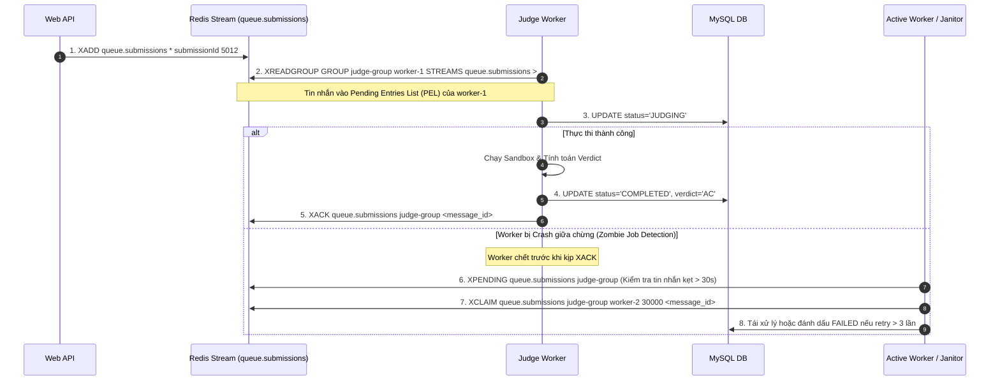

# TÀI LIỆU THIẾT KẾ KIẾN TRÚC HỆ THỐNG & ĐẶC TẢ KỸ THUẬT (SYSTEM ARCHITECTURE SPECIFICATION)
## DỰ ÁN: MINI LEETCODE PLATFORM
**Phiên bản:** 3.0.0 (Giải quyết triệt để các lỗ hổng bảo mật, độ nghẽn hiệu năng & độ tin cậy hàng đợi)  
**Tác giả:** Senior Software Architect  
**Trạng thái:** Production-Ready Architecture Baseline

---

## 1. TỔNG QUAN KIẾN TRÚC & NGUYÊN TẮC THIẾT KẾ (ARCHITECTURE PRINCIPLES)

Nhằm khắc phục toàn diện các điểm yếu về bảo mật máy chủ, độ nghẽn I/O và sự cố mất dữ liệu hàng đợi, kiến trúc Mini LeetCode được thiết kế dựa trên 4 trụ cột:
1. **Triệt tiêu nguy cơ chiếm quyền Host (Zero Host Takeover Risk):** Tách biệt tuyệt đối giữa Web API hướng người dùng (Public Facing) và Judge Worker thực thi Sandbox. Web API **hoàn toàn không được mount `/var/run/docker.sock`**. Worker chạy cô lập với quyền hạn tối thiểu.
2. **Hàng đợi chống mất mát dữ liệu (Reliable Queue via Redis Streams / Dead-Letter):** Sử dụng Redis Streams (`XADD`, `XREADGROUP`, `XACK`) với Consumer Groups và cơ chế tái xử lý Pending Entries List (PEL), loại bỏ hoàn toàn hiện tượng "Zombie Jobs" khi Worker khởi động lại.
3. **Thực thi Sandbox Hiệu năng cao (Warm Container / Pool Runner Pattern):** Tối ưu hóa I/O, sử dụng cơ chế chia sẻ volume an toàn hoặc runner process tối ưu, triệt tiêu độ trễ khởi tạo `docker run` liên tục gây sập Docker Daemon.
4. **Cơ chế Testcase I/O Streaming:** Dữ liệu testcase lớn (từ vài MB đến vài chục MB) được lưu trữ dạng File Storage (Local/MinIO/S3), truyền vào Sandbox qua cơ chế File Streaming, không bao giờ load toàn bộ vào MySQL hoặc Heap Memory của Backend.

```mermaid
flowchart TD
    subgraph Client ["Client Tier (Next.js 14)"]
        Browser["Next.js App / Monaco Editor"]
        Watcher["Heartbeat & Proctoring Watcher"]
    end

    subgraph WebTier ["Web API Gateway (Spring Boot - No Docker Socket)"]
        PublicAPI["REST API & JWT Security"]
        HeartbeatService["Proctoring & Heartbeat Evaluator"]
        StorageService["Testcase File Manager"]
    end

    subgraph StorageInfra ["Data & Queue Tier"]
        MySQL[("MySQL 8.0 Primary DB")]
        RedisStreams[("Redis Streams: Submissions & Events")]
        FileStorage[("Testcase Storage (Filesystem / S3 Object)")]
    end

    subgraph JudgeTier ["Isolated Judge Tier (Specialized Host / Container)"]
        WorkerService["Judge Worker (Consumer Group)"]
        SandboxManager["Sandbox Manager (Warm Pool / Cgroups / Isolate)"]
        Sandboxes["Ephemeral Exec Sandboxes (--net none, non-root)"]
    end

    Browser -->|1. Submit Code| PublicAPI
    Watcher -->|2. Heartbeat Ping / Window Events| HeartbeatService
    HeartbeatService -->|Update State| MySQL

    PublicAPI -->|3. Save Submission Metadata| MySQL
    PublicAPI -->|4. XADD queue.submissions| RedisStreams
    
    WorkerService -->|5. XREADGROUP (Auto Claim PEL)| RedisStreams
    WorkerService -->|6. Stream Testcase Input| FileStorage
    WorkerService -->|7. Exec in Isolated Environment| SandboxManager
    SandboxManager --> Sandboxes
    Sandboxes -->|8. Raw Output, Metrics, ExitCode| SandboxManager
    
    WorkerService -->|9. Update Verdict, Runtime, Peak RAM| MySQL
    WorkerService -->|10. XACK & Cache Result| RedisStreams

    Browser -->|11. Exponential Backoff Polling| PublicAPI
    PublicAPI -->|12. Fast Cache Read| RedisStreams
```

---

## 2. GIẢI QUYẾT TRIỆT ĐỂ CÁC VẤN ĐỀ BẢO MẬT & KIẾN TRÚC

### 2.1 An ninh Sandbox: Loại bỏ nguy cơ Root Takeover qua Docker Socket

- **Vấn đề đã nhận diện:** Mount trực tiếp `/var/run/docker.sock` vào Web API container khiến ứng dụng nếu dính lỗ hổng bảo mật (như SQL Injection, Deserialization, RCE) sẽ bị hacker lợi dụng Docker API để leo quyền kiểm soát toàn bộ máy chủ host.
- **Giải pháp kiến trúc chuẩn:**
  1. **Tách biệt hoàn toàn (Physical / Service Segregation):**
     - Container `web-api` chỉ kết nối với MySQL và Redis. **Không có bất kỳ quyền hạn hay file socket nào liên quan đến Docker.**
     - Tiến trình `judge-worker` được tách thành một dịch vụ riêng biệt. Nếu triển khai trên cùng máy chủ vật lý, chỉ có `judge-worker` mới được cấu hình socket chạy quyền hạn riêng (sử dụng Docker Rootless mode hoặc Linux Sandbox độc lập như `nsjail`/`isolate`).
  2. **Cấu hình Sandbox Runner tối hậu:**
     - Mạng: `--network none` (Cô lập 100% mạng).
     - Bộ nhớ: `--memory 256m --memory-swap 256m` (Triệt tiêu Swap, cưỡng chế ngắt OOM để bắt mã phán quyết `MLE`).
     - Tiến trình: `--pids-limit 64` (Ngăn chặn hoàn toàn Fork Bomb).
     - Quyền hạn: `--cap-drop ALL`, chạy dưới User ID không đặc quyền `1001:1001`.
     - File system: `--read-only`, chỉ mount thư mục làm việc dạng Read-Only, vùng ghi tạm nằm trên RAM (`--tmpfs /tmp:rw,noexec,nosuid,size=32m`).

### 2.2 Xử lý Mã Độc: Loại bỏ Static Regex Blacklist

- **Vấn đề đã nhận diện:** Dùng Regex Blacklist (chặn `import os`, `System.exit`) là giải pháp ngây thơ. Kẻ tấn công dễ dàng vượt qua bằng Reflection (`Class.forName(...)`), Base64, mã hóa bytecode hoặc nạp động; ngược lại người dùng đặt biến vô tình trùng tên lại bị khóa bài oan (False Positive).
- **Giải pháp kiến trúc chuẩn:**
  1. **Tin tưởng Sandbox, không tin tưởng bộ lọc chuỗi:** Cho phép mọi cú pháp ngôn ngữ hợp lệ biên dịch bình thường. Toàn bộ hành vi của mã nguồn phải chịu sự chế tài của Sandbox OS-level.
  2. **Chặn System Calls qua Linux Seccomp Profile / AppArmor:**
     - Áp dụng cấu hình Seccomp Profile mặc định chặn các System Calls nguy hiểm: `ptrace`, `sys_chroot`, `setuid`, `setgid`, `socket`, `connect`, `reboot`.
     - Nếu code người dùng cố tình gọi `socket` hoặc `exec`, Kernel sẽ lập tức trả về tín hiệu lỗi (ví dụ: `EPERM` hoặc `SIGSYS`), chương trình kết thúc và hệ thống bắt phán quyết `RE` (Runtime Error) hoặc `SV` (Security Violation) một cách tự nhiên và an toàn.

### 2.3 Chống Gian lận Liêm chính: Nguyên tắc Server-Side Authority

- **Vấn đề đã nhận diện:** Client gửi trực tiếp số lần vi phạm (`tabSwitchCount: 2`) qua API khiến thí sinh có thể sửa gói tin bằng DevTools/Burp Suite để qua mặt.
- **Giải pháp kiến trúc chuẩn: State Machine & Server-Side Verification:**
  1. **Mô hình Heartbeat & Window State Report:**
     - Trong suốt thời gian thi, Client định kỳ gửi gói tin Heartbeat tối giản: `{ contestId, timestamp, windowFocused: boolean }`.
     - Khi xảy ra sự kiện `visibilitychange` hoặc `blur`, Client chỉ gửi **thời điểm phát sinh sự kiện (Event Timestamp)**:
       - `WINDOW_BLUR`: Thời điểm rời màn hình.
       - `WINDOW_FOCUS`: Thời điểm quay lại.
  2. **Thẩm quyền tính toán nằm 100% tại Máy chủ (Server Evaluation):**
     - Server nhận tín hiệu `WINDOW_BLUR` và lưu trạng thái `PENDING_AWAY`.
     - Khi nhận tín hiệu `WINDOW_FOCUS`, Server tự tính khoảng thời gian rời màn hình:
       $$\Delta T = T_{\text{focus}} - T_{\text{blur}}$$
     - **Ngưỡng dung sai (Grace Period):** Nếu $\Delta T < 1.5$ giây (vô tình click ngoài màn hình), Server bỏ qua không phạt.
     - Nếu $\Delta T \ge 1.5$ giây, Server tự động tăng biến đếm vi phạm trong Database (`violation_count = violation_count + 1`).
     - Khi `violation_count >= MAX_LIMIT`, Server cập nhật trạng thái thí sinh thành `BLOCKED`/`LOCKED`, vô hiệu hóa token làm bài của thí sinh.

---

### 2.4 Hàng đợi Bền vững: Khắc phục sự cố Zombie Jobs qua Redis Streams

- **Vấn đề đã nhận diện:** Sử dụng `BRPOPLPUSH` kết hợp lệnh $O(N)$ `LREM` dễ làm mất bài nộp khi Worker bị sập đột ngột (Zombie Jobs kẹt vĩnh viễn ở trạng thái `JUDGING`).
- **Giải pháp kiến trúc chuẩn: Redis Streams + Consumer Groups:**



---

### 2.5 Hiệu năng & Quy mô (Performance & Scalability Optimization)

#### 1. Cơ chế Chấm Code Hiệu năng cao (Khắc phục Docker Spawn Overhead):
- Thay vì `docker run` (tạo mới và hủy container cho từng testcase đơn lẻ gây sập Daemon khi có hàng trăm lượt submit đồng thời):
  - **Mỗi lượt nộp bài chỉ chạy đúng 1 Container Ephemeral duy nhất cho toàn bộ bộ test:**
    - Worker mount thư mục chứa mã nguồn và danh sách testcase (chế độ Read-Only).
    - Bên trong container, một runner tiến trình tối giản (viết bằng C hoặc Python nhúng) đọc qua từng testcase, đo đạc thời gian CPU và bộ nhớ bằng system calls nội tại.
    - Container kết thúc và hủy trong 1 lần duy nhất sau khi chạy xong toàn bộ testcases (hoặc dừng sớm ngay khi gặp testcase đầu tiên bị sai / TLE).

#### 2. Chống Thundering Herd: Exponential Backoff & Dynamic Polling:
- Phía Client không poll cứng mỗi 1.5 giây. Thay vào đó, áp dụng thuật toán **Adaptive Polling kèm Jitter**:
  - Lần 1: Sau khi nộp bài 1.0 giây (thời gian tối thiểu cho các bài nộp siêu nhanh).
  - Lần 2: 2.0 giây.
  - Lần 3: 3.5 giây.
  - Lần 4 trở đi: Cứ mỗi 5.0 giây (kèm sai số ngẫu nhiên $\pm 500\text{ms}$ để phân tán tải).
  - Tích hợp Header `Retry-After` trả về từ Backend khi hàng đợi đang quá tải.
  - Kết quả được lưu tại Redis Key `cache:submission:{id}` với TTL 1 giờ để đảm bảo truy xuất $O(1)$ không chạm tới MySQL.

#### 3. Quản lý Testcase Lớn (Tránh tràn RAM MySQL & Backend Heap):
- Cột trong MySQL chỉ lưu Metadata: `id`, `problem_id`, `input_file_uri`, `output_file_uri`, `is_hidden`, `byte_size`.
- Dữ liệu I/O thực tế được lưu dưới dạng file trên ổ đĩa chuyên dụng (Volume Mount hoặc MinIO/S3).
- Khi chấm bài, Worker truyền file I/O vào Sandbox dưới dạng Stream hoặc trực tiếp mount thư mục file testcase vào container, **tuyệt đối không đọc toàn bộ chuỗi hàng chục MB vào bộ nhớ RAM của Java Backend**.

---

## 3. THIẾT KẾ CƠ SỞ DỮ LIỆU CHUẨN HÓA (MYSQL 8.0 DDL)

```sql
-- 1. Bảng Users
CREATE TABLE users (
    id BIGINT AUTO_INCREMENT PRIMARY KEY,
    username VARCHAR(50) NOT NULL UNIQUE,
    email VARCHAR(100) NOT NULL UNIQUE,
    password_hash VARCHAR(255) NOT NULL,
    role ENUM('USER', 'INSTRUCTOR', 'ADMIN') NOT NULL DEFAULT 'USER',
    status ENUM('ACTIVE', 'BLOCKED') NOT NULL DEFAULT 'ACTIVE',
    created_at TIMESTAMP DEFAULT CURRENT_TIMESTAMP,
    updated_at TIMESTAMP DEFAULT CURRENT_TIMESTAMP ON UPDATE CURRENT_TIMESTAMP,
    INDEX idx_users_username (username),
    INDEX idx_users_email (email)
) ENGINE=InnoDB DEFAULT CHARSET=utf8mb4 COLLATE=utf8mb4_unicode_ci;

-- 2. Bảng Problems
CREATE TABLE problems (
    id BIGINT AUTO_INCREMENT PRIMARY KEY,
    title VARCHAR(200) NOT NULL,
    slug VARCHAR(200) NOT NULL UNIQUE,
    description MEDIUMTEXT NOT NULL,
    difficulty ENUM('EASY', 'MEDIUM', 'HARD') NOT NULL,
    time_limit_ms INT NOT NULL DEFAULT 1000,
    memory_limit_mb INT NOT NULL DEFAULT 256,
    status ENUM('DRAFT', 'REVIEWING', 'PUBLISHED', 'ARCHIVED') NOT NULL DEFAULT 'DRAFT',
    created_by BIGINT NOT NULL,
    created_at TIMESTAMP DEFAULT CURRENT_TIMESTAMP,
    updated_at TIMESTAMP DEFAULT CURRENT_TIMESTAMP ON UPDATE CURRENT_TIMESTAMP,
    CONSTRAINT fk_problems_creator FOREIGN KEY (created_by) REFERENCES users(id),
    INDEX idx_problems_status_diff (status, difficulty),
    INDEX idx_problems_slug (slug)
) ENGINE=InnoDB DEFAULT CHARSET=utf8mb4 COLLATE=utf8mb4_unicode_ci;

-- 3. Bảng Test Cases (Chỉ lưu đường dẫn File Reference, không lưu nội dung I/O lớn)
CREATE TABLE test_cases (
    id BIGINT AUTO_INCREMENT PRIMARY KEY,
    problem_id BIGINT NOT NULL,
    input_file_uri VARCHAR(500) NOT NULL COMMENT 'Đường dẫn file storage chứa input',
    expected_output_uri VARCHAR(500) NOT NULL COMMENT 'Đường dẫn file storage chứa expected output',
    is_hidden BOOLEAN NOT NULL DEFAULT TRUE,
    order_index INT NOT NULL DEFAULT 0,
    file_size_bytes BIGINT NOT NULL DEFAULT 0,
    created_at TIMESTAMP DEFAULT CURRENT_TIMESTAMP,
    CONSTRAINT fk_testcase_problem FOREIGN KEY (problem_id) REFERENCES problems(id) ON DELETE CASCADE,
    INDEX idx_testcases_problem (problem_id, is_hidden)
) ENGINE=InnoDB DEFAULT CHARSET=utf8mb4 COLLATE=utf8mb4_unicode_ci;

-- 4. Bảng Contests / Exams
CREATE TABLE contests (
    id BIGINT AUTO_INCREMENT PRIMARY KEY,
    title VARCHAR(200) NOT NULL,
    slug VARCHAR(200) NOT NULL UNIQUE,
    start_time TIMESTAMP NOT NULL,
    end_time TIMESTAMP NOT NULL,
    scoring_policy ENUM('ACM_ICPC', 'PARTIAL_IOI') NOT NULL DEFAULT 'ACM_ICPC',
    max_violations_allowed INT NOT NULL DEFAULT 3,
    status ENUM('SCHEDULED', 'RUNNING', 'COMPLETED') NOT NULL DEFAULT 'SCHEDULED',
    created_by BIGINT NOT NULL,
    created_at TIMESTAMP DEFAULT CURRENT_TIMESTAMP,
    CONSTRAINT fk_contest_creator FOREIGN KEY (created_by) REFERENCES users(id)
) ENGINE=InnoDB DEFAULT CHARSET=utf8mb4;

-- 5. Bảng Hồ sơ Thí sinh trong phòng thi
CREATE TABLE contest_participants (
    id BIGINT AUTO_INCREMENT PRIMARY KEY,
    contest_id BIGINT NOT NULL,
    user_id BIGINT NOT NULL,
    status ENUM('REGISTERED', 'IN_PROGRESS', 'SUBMITTED', 'DISQUALIFIED') NOT NULL DEFAULT 'REGISTERED',
    violation_count INT NOT NULL DEFAULT 0,
    last_away_start_time TIMESTAMP NULL,
    score INT NOT NULL DEFAULT 0,
    penalty_time_minutes INT NOT NULL DEFAULT 0,
    created_at TIMESTAMP DEFAULT CURRENT_TIMESTAMP,
    CONSTRAINT fk_cp_contest FOREIGN KEY (contest_id) REFERENCES contests(id) ON DELETE CASCADE,
    CONSTRAINT fk_cp_user FOREIGN KEY (user_id) REFERENCES users(id),
    UNIQUE KEY uq_contest_user (contest_id, user_id)
) ENGINE=InnoDB DEFAULT CHARSET=utf8mb4;

-- 6. Bảng Submissions
CREATE TABLE submissions (
    id BIGINT AUTO_INCREMENT PRIMARY KEY,
    user_id BIGINT NOT NULL,
    problem_id BIGINT NOT NULL,
    contest_id BIGINT NULL,
    language ENUM('JAVA', 'PYTHON', 'CPP') NOT NULL,
    code_storage_uri VARCHAR(500) NOT NULL,
    status ENUM('PENDING', 'JUDGING', 'COMPLETED', 'FAILED') NOT NULL DEFAULT 'PENDING',
    verdict ENUM('AC', 'WA', 'TLE', 'MLE', 'CE', 'RE', 'SV', 'FLAGGED_CHEATING') DEFAULT NULL,
    execution_time_ms INT DEFAULT NULL,
    memory_used_kb INT DEFAULT NULL,
    pass_test_cases INT NOT NULL DEFAULT 0,
    total_test_cases INT NOT NULL DEFAULT 0,
    error_message TEXT DEFAULT NULL,
    retry_count INT NOT NULL DEFAULT 0,
    created_at TIMESTAMP DEFAULT CURRENT_TIMESTAMP,
    updated_at TIMESTAMP DEFAULT CURRENT_TIMESTAMP ON UPDATE CURRENT_TIMESTAMP,
    CONSTRAINT fk_sub_user FOREIGN KEY (user_id) REFERENCES users(id),
    CONSTRAINT fk_sub_problem FOREIGN KEY (problem_id) REFERENCES problems(id),
    CONSTRAINT fk_sub_contest FOREIGN KEY (contest_id) REFERENCES contests(id),
    INDEX idx_sub_user_created (user_id, created_at DESC),
    INDEX idx_sub_status (status)
) ENGINE=InnoDB DEFAULT CHARSET=utf8mb4 COLLATE=utf8mb4_unicode_ci;

-- 7. Bảng Nhật ký Giám sát (Proctoring Audit Logs)
CREATE TABLE proctoring_logs (
    id BIGINT AUTO_INCREMENT PRIMARY KEY,
    contest_id BIGINT NOT NULL,
    user_id BIGINT NOT NULL,
    event_type ENUM('WINDOW_BLUR', 'WINDOW_FOCUS', 'PASTE_SPIKE', 'HEARTBEAT_TIMEOUT') NOT NULL,
    duration_ms INT DEFAULT NULL,
    metadata JSON NULL,
    created_at TIMESTAMP DEFAULT CURRENT_TIMESTAMP,
    CONSTRAINT fk_log_contest FOREIGN KEY (contest_id) REFERENCES contests(id) ON DELETE CASCADE,
    CONSTRAINT fk_log_user FOREIGN KEY (user_id) REFERENCES users(id),
    INDEX idx_proctoring_audit (contest_id, user_id, event_type)
) ENGINE=InnoDB DEFAULT CHARSET=utf8mb4 COLLATE=utf8mb4_unicode_ci;
```

---

## 4. ĐẶC TẢ API CONTRACTS (RESTFUL STANDARD)

### 4.1 Submissions API (Asynchronous Submission Flow)
- **`POST /api/v1/submissions`**
  - **Header:** `Authorization: Bearer <jwt_token>`
  - **Request Body:**
    ```json
    {
      "problemId": 101,
      "contestId": null,
      "language": "JAVA",
      "code": "class Solution { public int[] twoSum(int[] nums, int target) { ... } }"
    }
    ```
  - **Response 202 Accepted:**
    ```json
    {
      "code": 202,
      "message": "Submission received and queued for evaluation.",
      "data": {
        "submissionId": 8092,
        "status": "PENDING",
        "initialRetryDelayMs": 1000
      }
    }
    ```

- **`GET /api/v1/submissions/{submissionId}`**
  - **Response 200 OK (Completed):**
    ```json
    {
      "code": 200,
      "message": "Success",
      "data": {
        "id": 8092,
        "status": "COMPLETED",
        "verdict": "AC",
        "executionTimeMs": 42,
        "memoryUsedKb": 38400,
        "passedRatio": "15/15",
        "errorMessage": null
      }
    }
    ```

### 4.2 Proctoring & State Tracking API
- **`POST /api/v1/contests/{contestId}/events`**
  - **Header:** `Authorization: Bearer <jwt_token>`
  - **Mục đích:** Báo cáo sự kiện mất/nhận focus để Server tính toán thời gian vi phạm.
  - **Request Body (Khi rời khỏi cửa sổ):**
    ```json
    {
      "eventType": "WINDOW_BLUR",
      "clientTimestamp": 1728123456000
    }
    ```
  - **Request Body (Khi quay lại cửa sổ):**
    ```json
    {
      "eventType": "WINDOW_FOCUS",
      "clientTimestamp": 1728123459500
    }
    ```
  - **Response 200 OK:**
    ```json
    {
      "code": 200,
      "message": "Event processed by server",
      "data": {
        "violationRegistered": true,
        "currentViolations": 2,
        "maxViolations": 3,
        "isDisqualified": false,
        "message": "Cảnh báo: Bạn đã rời khỏi màn hình 3.5 giây. Số lần vi phạm: 2/3."
      }
    }
    ```
