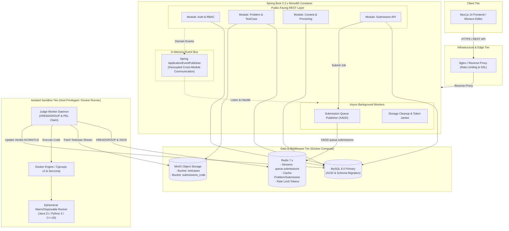

# ARCHITECTURAL DESIGN & SCALABILITY REVIEW
## DỰ ÁN: MINI LEETCODE PLATFORM (MODULAR MONOLITH STRATEGY)

> **Tài liệu kiến trúc chính thức:** ADR-001 — Scaling & Maintainability without Microservices  
> **Tác giả:** Principal System Architect  
> **Trạng thái:** Approved Architecture Baseline  

---

## 1. TỔNG QUAN YÊU CẦU & THÁCH THỨC QUY MÔ (NFR & SCALABILITY ANALYSIS)

### 1.1 Mục tiêu hệ thống
Xây dựng nền tảng thi và luyện tập thuật toán có khả năng:
- Chịu tải đồng thời trong các kỳ thi (**Peak Load**: 500 – 2,000 thí sinh đồng thời nộp bài và nhận verdict trong contest).
- Bảo trì dễ dàng khi tính năng phình to (Problem, TestCase, Contest, Leaderboard, Anti-Cheat, Plagiarism, Code Sandbox).
- **Tuyệt đối không phân rã thành Microservices**: Loại bỏ chi phí vận hành mạng, latency phân tán, distributed transactions (Saga/2PC), phức tạp trong CI/CD và deployment overhead.

### 1.2 Bảng phân tích các điểm nghẽn quy mô (Scale Bottlenecks)

| Điểm nghẽn tiềm tàng | Nguy cơ khi tải tăng cao | Giải pháp kiến trúc chuẩn Modular Monolith |
|---|---|---|
| **Database Connection Exhaustion** | Hàng nghìn request đọc/ghi đồng thời làm cạn kiệt pool HikariCP, gây treo API | Tinh chỉnh HikariCP (leak detection, timeout), phân tách transaction readonly, sẵn sàng Read-Replica routing. |
| **Monolith Spaghetti Code** | Khi thêm Contest, Leaderboard, Anti-cheat... các service gọi chéo nhau tạo thành đồ thị phụ thuộc vòng (circular dependency) | Tổ chức **Package-by-Feature (Modular Monolith)** với bounded contexts rõ ràng. Giao tiếp liên domain qua Service Interface hoặc Spring Domain Events (`ApplicationEventPublisher`). |
| **Worker Block & CPU Starvation** | Đợt nộp bài lớn làm nghẽn tiến trình API nếu worker chạy chung threadpool | Tách biệt tuyệt đối hàng đợi bằng **Redis Streams** (`queue.submissions`). Worker tiêu thụ độc lập qua Consumer Groups, không cạnh tranh CPU/RAM với Web API. |
| **File I/O & Memory Heap Overhead** | Hàng trăm testcase dung lượng lớn nạp cùng lúc vào RAM làm sập JVM Heap | **MinIO Object Storage** streaming I/O trực tiếp, DB chỉ lưu URI và metadata kích thước file. |
| **Container Daemon Saturation** | `docker run` per-testcase làm sập Docker Daemon khi thi đấu | Gom cụm toàn bộ testcases của 1 bài nộp vào **1 Ephemeral Runner duy nhất** (Early Exit on first failure). |

---

## 2. KIẾN TRÚC HỆ THỐNG TỔNG THỂ (MODULAR MONOLITH ARCHITECTURE)

---

## 3. ARCHITECTURE DECISION RECORD (ADR)

### ADR-001: Modular Monolith với Decoupled Redis Streams & Object Storage

- **Trạng thái:** ACCEPTED
- **Bối cảnh:**
  Dự án Mini LeetCode Platform đang phát triển nhanh chóng. Khi quy mô người dùng tăng lên trong các kỳ thi, hệ thống đối mặt với 2 rủi ro đối lập:
  1. Nếu chia tách microservices quá sớm: Hệ thống sẽ phát sinh độ trễ mạng, chi phí bảo trì phức tạp, bài toán phân tán dữ liệu và vượt quá năng lực vận hành của team.
  2. Nếu duy trì một Monolith nguyên khối không cấu trúc: Mã nguồn sẽ biến thành "Big Ball of Mud", phụ thuộc vòng giữa các domain và gây sập hệ thống khi chịu tải nặng.
- **Quyết định kiến trúc:**
  1. **Triển khai kiến trúc Modular Monolith (Package-by-Feature):**
     - Chia ứng dụng thành các bounded context độc lập: `auth`, `problem`, `testcase`, `submission`, `contest`, `storage`, `common`.
     - Tuyệt đối cấm import cross-domain trực tiếp tầng Persistence (Repository); chỉ giao tiếp qua Service Interface hoặc bất đồng bộ qua `ApplicationEventPublisher`.
  2. **Bổ sung Redis 7.x vào Core Infrastructure (`docker-compose.yml`):**
     - Đảm nhiệm 3 vai trò:
       - Hàng đợi bền vững (Redis Streams `queue.submissions`) với Consumer Groups và PEL Recovery.
       - Cache kết quả chấm bài (`cache:submission:{id}`) với TTL để chống Thundering Herd.
       - Distributed Rate Limiting bảo vệ các endpoints đăng nhập và submit.
  3. **Tối ưu hóa Connection Pool HikariCP:**
     - Thiết lập tường minh kích thước pool, idle timeout và cơ chế phát hiện rò rỉ kết nối `leak-detection-threshold`.
  4. **Cách ly hoàn toàn Worker Sandbox:**
     - Không mount Docker socket vào Web API. Worker tiêu thụ job từ Redis Streams, mount file testcase và code dưới dạng Read-Only Volume vào Runner.
- **Hệ quả & Đánh đổi (Trade-offs):**
  - *Điểm mạnh:* Vận hành 1-click qua Docker Compose, chi phí server tối thiểu, dễ debug nội bộ, tốc độ dev nhanh, zero network latency giữa các module nội bộ.
  - *Đánh đổi:* Cần kỷ luật review code nghiêm ngặt để giữ sạch ranh giới giữa các module trong Monolith (đã có bộ test kiến trúc hỗ trợ).

---

## 4. KẾ HOẠCH TỐI ƯU HẠ TẦNG (INFRASTRUCTURE REFACTORING PLAN)

1. **Refactor `docker-compose.yml`:**
   - Bổ sung service **Redis 7.x** (với `appendonly yes`, maxmemory policy, healthcheck, và volume lưu trữ bền vững).
   - Thiết lập mạng nội bộ độc lập `mini_leetcode_network` cô lập các containers.
   - Thêm resource limits (`mem_limit`, `cpus`) để ngăn chặn việc một container ngốn sạch tài nguyên máy chủ host.
2. **Refactor `application.yml` & `application-local.yml`:**
   - Cấu hình tường minh thông số **HikariCP connection pool** (max-pool-size, leak-detection-threshold, connection-timeout).
   - Bổ sung cấu hình kết nối **Redis** (`spring.data.redis`).
   - Kích hoạt **Spring Boot Actuator** (`/actuator/health`, `/actuator/info`, `/actuator/metrics`) phục vụ giám sát sức khỏe runtime khi quy mô tăng.
