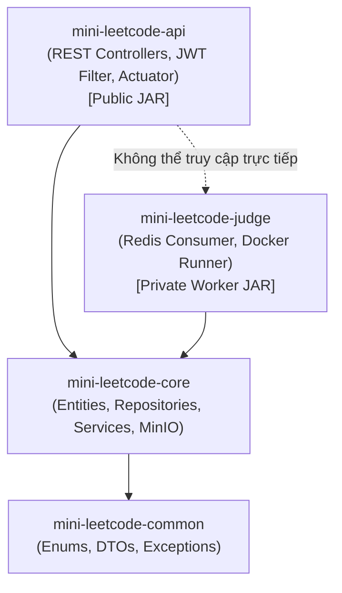

# ARCHITECTURAL DECISION RECORD (ADR)
## ADR-002: Chuyển đổi sang kiến trúc Maven Multi-Module Monolith (Dual-Target Deployment)

- **Trạng thái:** ACCEPTED
- **Ngày quyết định:** 2026-10-23
- **Tác giả:** Principal Software Architect / Backend Lead

---

## 1. Bối cảnh & Vấn đề (Context)

Dự án Mini LeetCode đang bước qua Phase 1 và chuẩn bị bước vào Phase 2 (Sandbox Runner, Redis Streams Job Queue, Anti-Cheat proctoring).
Nếu giữ toàn bộ mã nguồn trong một Maven module đơn lẻ (`mini_leetcode`), hệ thống sẽ đối mặt với các nguy cơ:
1. **Rò rỉ ranh giới domain (Boundary Leaks):** Tầng Web Controller có thể vô tình gọi trực tiếp các phương thức hạ tầng hoặc thậm chí chạm vào Docker socket của Sandbox.
2. **Nguy cơ bảo mật Host Takeover:** Nếu đóng gói chung 1 file JAR duy nhất chứa cả Web API công khai và Docker runner engine, một lỗ hổng RCE trên Web API có thể dẫn đến việc chiếm quyền toàn bộ máy chủ qua Docker privileges.
3. **Khó phân chia vai trò nhóm:** 3 kỹ sư (Backend Lead, Sandbox Specialist, Frontend Lead) làm việc trên cùng 1 module sẽ liên tục bị xung đột git merge conflicts và chồng chéo dependencies.

---

## 2. Quyết định kiến trúc (Decision)

Chúng ta quyết định tái cấu trúc mã nguồn Backend từ Single-Module sang **Maven Multi-Module Monolith**, chia thành 4 modules độc lập:

```
mini_leetcode/ (Parent POM, packaging: pom)
├── mini-leetcode-common/      # Không phụ thuộc Spring/DB: Enums, DTOs, Exceptions, RFC 7807 models
├── mini-leetcode-core/        # Nghiệp vụ lõi & Dữ liệu: JPA Entities, Repositories, Services, MinIO Storage, Flyway
├── mini-leetcode-api/         # Web REST API (Public-facing): Controllers, JWT Security, Swagger, Actuator (Executable JAR)
└── mini-leetcode-judge/       # Sandbox Worker (Private): Redis Streams Consumer, Docker Runner, Cgroups monitor (Executable JAR)
```

### Ranh giới phụ thuộc một chiều (Strict Dependency Graph):



---

## 3. Lợi ích kỹ thuật & Khả năng mở rộng (Scalability & Maintainability)

1. **Ranh giới do Trình biên dịch ép buộc (Compiler-Enforced Isolation):**
   - `mini-leetcode-api` hoàn toàn không có dependency tới Docker Client hay Docker daemon socket. Trình biên dịch Java sẽ báo lỗi nếu ai đó cố tình gọi logic runner trong Web API.
2. **Chiến lược Dual-Target Packaging:**
   - Cùng nằm trong 1 repo Monolith duy nhất (dễ quản lý, không overhead microservices).
   - Nhưng khi build có thể tạo ra 2 container images tách biệt:
     - `mini-leetcode-api`: Container chạy REST Web API, expose port 8080 ra ngoài, **không mount docker.sock**.
     - `mini-leetcode-judge`: Container worker nội bộ, chỉ kết nối Redis, mount docker socket trong môi trường cô lập.
3. **Phân chia công việc song song không xung đột:**
   - Kỹ sư 1 (Backend Lead) làm chủ module `core` và `api`.
   - Kỹ sư 2 (Sandbox Specialist) làm việc hoàn toàn độc lập trong module `judge`.
   - Kỹ sư 3 (Frontend Lead) chỉ cần quan tâm tới API contracts xuất ra từ `api` qua OpenAPI 3.1.

---

## 4. Đánh đổi (Trade-offs)

- Cần quản lý cấu hình dependency versions tập trung tại `<dependencyManagement>` ở parent POM.
- Việc refactor model giữa các module cần sự thống nhất về schema (được bảo vệ bởi Flyway migrations trong module `core`).
