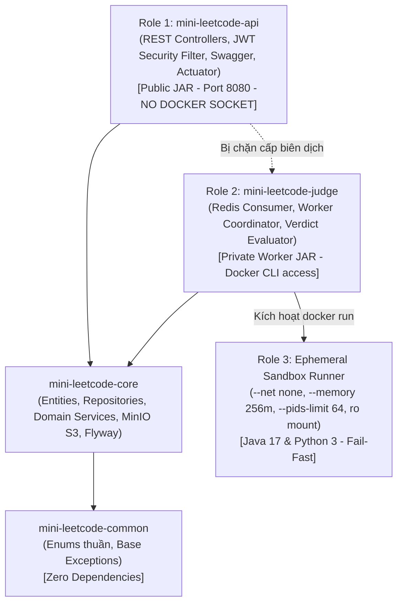

# Mini LeetCode Platform — System Onboarding & Context Guide
> **Tài liệu Bối cảnh Kiến trúc Dành cho Đội ngũ Agent (Agent Context Injection)**
> Được khởi tạo theo chuẩn `/understand-onboard` | Phiên bản: 1.0.0

---

## 1. Tổng quan Dự án (Project Overview)

Mini LeetCode là nền tảng luyện thuật toán và chấm bài trực tuyến (Online Judge) hỗ trợ hàng nghìn người dùng đồng thời, tổ chức các kỳ thi thuật toán (Contest) theo chuẩn ACM/ICPC, và thực thi mã nguồn thí sinh trong môi trường Sandbox bảo mật cao.

- **Ngôn ngữ chính:** Java 21 LTS, SQL (MySQL 8.0 Dialect), Dockerfile / Shell script.
- **Frameworks cốt lõi:** Spring Boot 3.3+, Spring Data JPA, Spring Security 6 (Stateless JWT), Flyway Migration.
- **Hạ tầng hỗ trợ (Infrastructure):**
  - **MySQL 8.0:** Lưu trữ dữ liệu quan hệ (Users, Problems, TestCases, Submissions, Contests).
  - **Java 17 LTS:** Nền tảng thực thi chuẩn hóa cho toàn bộ Backend và Sandbox Runner.
  - **Redis 7 (Alpine):** Hàng đợi xử lý bài nộp (`queue.submissions`), cache bảng xếp hạng Leaderboard, kiểm soát brute-force rate limit.
  - **MinIO Object Storage:** Lưu trữ file input/output của bộ testcase lớn và mã nguồn bài nộp theo chuẩn giao thức AWS S3.
  - **Docker Engine (Ephemeral Container Runner):** Động cơ cô lập sandbox worker an toàn qua các cờ `--network none`, `--memory 256m`, `--pids-limit 64`, Read-Only mount (chi tiết tại [ADR-004](file:///c:/Users/aDMIN/Documents/JSD/Mini%20Leetcode/docs/ADR-004_PRAGMATIC_SANDBOX_DESIGN.md)).

---

## 2. Kiến trúc Hệ thống & Phân chia 3 Role Sandbox (System Architecture Layers)

Dự án áp dụng mô hình **Maven Multi-Module Monolith** phân định ranh giới phụ thuộc một chiều, đóng gói thành các thành phần chuyên trách theo 3 Roles (xem chi tiết tại [ADR-002](file:///c:/Users/aDMIN/Documents/JSD/Mini%20Leetcode/docs/ADR-002_MAVEN_MULTI_MODULE_MONOLITH.md) và [ADR-004](file:///c:/Users/aDMIN/Documents/JSD/Mini%20Leetcode/docs/ADR-004_PRAGMATIC_SANDBOX_DESIGN.md)):



### Các Module vật lý & Phân định Role:
1. **`mini-leetcode-common`:**
   - Hoàn toàn không phụ thuộc Spring Boot hay Database.
   - Chứa Enums miền (`Role`, `Difficulty`, `ProblemStatus`, `UserStatus`) và Base Exceptions (`ResourceNotFoundException`, `DuplicateResourceException`, `InvalidTokenException`, `StorageException`).
2. **`mini-leetcode-core`:**
   - Tầng nghiệp vụ lõi và lưu trữ dữ liệu.
   - Chứa JPA Entities, Spring Data Repositories, Services, cấu hình MinIO SDK (`MinioStorageService`), bảo mật core (`JwtTokenProvider`, `CustomUserDetailsService`), Flyway schema migrations (`db/migration/V1__init_schema.sql`).
3. **`mini-leetcode-api` (Role 1 - Web API Gateway):**
   - Ứng dụng Web RESTful công khai (chứa hàm `main` tại `MiniLeetcodeApplication`).
   - Cung cấp REST endpoints, Spring Security Filter Chain, OpenAPI 3.1 Swagger UI (`/swagger-ui.html`), RFC 7807 Exception Advice (`GlobalExceptionHandler`).
   - Tiếp nhận nộp bài, lưu `PENDING` và đẩy vào Redis Queue.
   - **Tuyệt đối không mount `/var/run/docker.sock`** để ngăn chặn triệt để nguy cơ Root Host Takeover.
4. **`mini-leetcode-judge` (Role 2 - Judge Worker) & Sandbox Runner (Role 3):**
   - Worker chạy ngầm, không mở port public. Lắng nghe jobs chấm bài qua Redis Queue (`queue.submissions`).
   - Tải testcase về thư mục tạm cục bộ `temp-submissions/{id}/`, mount Read-Only vào Runner container (hỗ trợ Java 17 và Python 3).
   - Thu thập kết quả theo cơ chế Fail-Fast (ngắt ngay khi gặp testcase lỗi đầu tiên), tính toán Verdict và cập nhật cơ sở dữ liệu.

---

## 3. Cấu trúc Đóng gói: Feature-First với Sub-packages nội bộ

Tuân thủ nghiêm ngặt theo [ADR-003](file:///c:/Users/aDMIN/Documents/JSD/Mini%20Leetcode/docs/ADR-003_PACKAGE_BY_FEATURE_STRUCTURE.md) (không được phép gom tất cả vào chung một package phẳng hay package-by-layer hỗn tạp):

```
mini_leetcode/
├── mini-leetcode-core/src/main/java/jsd/toiyeujava/mini_leetcode/
│   ├── auth/
│   │   ├── entity/           # User.java, RefreshToken.java
│   │   ├── repository/       # UserRepository.java, RefreshTokenRepository.java
│   │   ├── service/          # AuthService.java
│   │   ├── dto/              # LoginRequest, RegisterRequest, AuthResponse, UserDto, ...
│   │   └── security/         # JwtTokenProvider, CustomUserDetailsService, UserPrincipal
│   ├── problem/
│   │   ├── entity/           # Problem.java
│   │   ├── repository/       # ProblemRepository.java
│   │   ├── service/          # ProblemService.java
│   │   └── dto/              # CreateProblemRequest, UpdateProblemRequest, ProblemResponse
│   ├── testcase/
│   │   ├── entity/           # TestCase.java
│   │   ├── repository/       # TestCaseRepository.java
│   │   ├── service/          # TestCaseService.java
│   │   └── dto/              # TestCaseResponse.java
│   └── storage/
│       ├── config/           # MinioConfig.java
│       └── service/          # StorageService.java, MinioStorageService.java
│
└── mini-leetcode-api/src/main/java/jsd/toiyeujava/mini_leetcode/
    ├── auth/controller/      # AuthController.java (/api/v1/auth)
    ├── problem/controller/   # ProblemController.java (/api/v1/problems)
    ├── testcase/controller/  # TestCaseController.java (/api/v1/problems/{id}/test-cases)
    ├── security/             # SecurityConfig.java, JwtAuthenticationFilter.java, Handlers
    ├── config/               # OpenApiConfig.java
    └── exception/            # GlobalExceptionHandler.java
```

---

## 4. Các Quy chuẩn Kỹ thuật Bắt buộc (Non-Negotiable Rules)

1. **Chuẩn mã lỗi RFC 7807 (Problem Details):**
   - Mọi lỗi HTTP 4xx và 5xx đều phải trả về định dạng `application/problem+json` gồm: `type`, `title`, `status`, `detail`, `instance`, `timestamp`, `invalid_params`.
2. **Bảo toàn Bộ nhớ & Streaming I/O:**
   - Dữ liệu testcase và file mã nguồn lớn tuyệt đối không được đọc vào mảng byte (`byte[]`) trên RAM JVM. Phải truyền tải thẳng qua `InputStream` của `MinioStorageService`.
3. **Bảo mật JWT Stateless:**
   - Access token lưu trong bộ nhớ client, thời hạn 30 phút.
   - Refresh token lưu trong DB dưới dạng SHA-256 hash, áp dụng Refresh Token Rotation (RTR). Tái sử dụng token cũ lập tức thu hồi toàn bộ token family của user.
   - Public self-registration luôn gán cứng `Role.USER`, ngăn chặn privilege escalation.
4. **Không sử dụng Mock/Stub trong Implementation Code:**
   - Code nghiệp vụ phải chạy thật với cơ sở dữ liệu và hạ tầng (sử dụng H2 in-memory mode hoặc container cho integration tests).
5. **Tiêu chuẩn Kiểm thử 100% Pass:**
   - Dự án hiện có **79/79 automated tests** (Integration tests, Adversarial tests, Unit tests). Mọi thay đổi đều phải chạy lệnh kiểm tra:
     ```powershell
     cd mini_leetcode
     .\mvnw clean test
     ```
   - Nếu có bất kỳ test nào fail, code không được phép chấp thuận.
