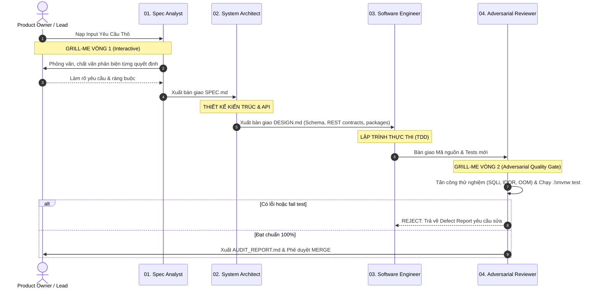

# MULTI-AGENT MARKDOWN PIPELINE WITH GRILL-ME GATING
> **Quy trình Điều phối Đội ngũ 4 Agent Chuyên biệt cho Mini LeetCode**
> Thư mục định nghĩa: `docs/team-pipeline/`

---

## 1. Sơ đồ Vòng đời Thực thi (Pipeline Execution Flow)

Mọi yêu cầu công việc mới (Feature mới, Refactoring, Bug fix, Tích hợp mới) khi đưa vào hệ thống đều trải qua quy trình tuần tự 4 chặng:



---

## 2. Chi tiết 4 Cổng Kiểm soát (The 4 Quality Gates)

| Chặng | Agent Chuyên trách | Đầu vào (Input) | Đầu ra (Output) | Cơ chế Gating / Chất vấn |
|---|---|---|---|---|
| **Gate 1** | [01_spec_analyst.md](file:///c:/Users/aDMIN/Documents/JSD/Mini%20Leetcode/docs/team-pipeline/01_spec_analyst.md) | Yêu cầu thô từ User | `SPEC.md` | **Interactive Grill-Me vòng 1:** Phỏng vấn người dùng qua `ask_question` để bóc trần mọi giả định mơ hồ. |
| **Gate 2** | [02_system_architect.md](file:///c:/Users/aDMIN/Documents/JSD/Mini%20Leetcode/docs/team-pipeline/02_system_architect.md) | `SPEC.md` | `DESIGN.md` | **Architectural Review:** Đảm bảo ranh giới Maven Multi-Module, Package-by-Feature và chuẩn OpenAPI 3.1. |
| **Gate 3** | [03_software_engineer.md](file:///c:/Users/aDMIN/Documents/JSD/Mini%20Leetcode/docs/team-pipeline/03_software_engineer.md) | `DESIGN.md` | Production Code & Unit/Integration Tests | **TDD & Self-Verification:** Không có stub/mock ẩu, code tuân thủ clean code. |
| **Gate 4** | [04_adversarial_reviewer.md](file:///c:/Users/aDMIN/Documents/JSD/Mini%20Leetcode/docs/team-pipeline/04_adversarial_reviewer.md) | Codebase hoàn chỉnh | `AUDIT_REPORT.md` (Approved/Rejected) | **Adversarial Grill-Me vòng 2:** Rà soát OWASP, IDOR, heap memory leaks và chạy toàn bộ test suite `.\mvnw test`. |

---

## 3. Hướng dẫn Kích hoạt Pipeline cho Người dùng (How to Run)

Khi có một tính năng hoặc task mới cần triển khai, người dùng chỉ cần thực hiện theo các bước sau trong Antigravity Chat:

### Cách kích hoạt:
1. **Gửi lệnh kích hoạt Pipeline:**
   ```text
   /teamwork-preview Hãy bắt đầu triển khai tính năng [Tên tính năng] theo pipeline tại docs/team-pipeline/PIPELINE.md
   ```
2. **Giai đoạn 1 (Grill-Me vòng 1):** 
   - Agent 01 sẽ chào bạn và xuất hiện modal `ask_question` hỏi bạn từ 2-4 câu hỏi cốt lõi để làm rõ nghiệp vụ.
   - Bạn chọn các phương án hoặc nhập thêm yêu cầu đặc thù.
   - Agent 01 lưu file `SPEC.md`.
3. **Giai đoạn 2 (Thiết kế Kiến trúc):**
   - Agent 02 tự động đối chiếu [docs/team-pipeline/ONBOARDING.md](file:///c:/Users/aDMIN/Documents/JSD/Mini%20Leetcode/docs/team-pipeline/ONBOARDING.md) và xuất file `DESIGN.md`.
4. **Giai đoạn 3 (Thực thi Mã nguồn):**
   - Agent 03 viết migration, entity, repository, service, DTO và controller theo đúng package-by-feature.
5. **Giai đoạn 4 (Kiểm định Đối kháng):**
   - Agent 04 rà soát security checklist, tự động chạy `.\mvnw test` trong terminal.
   - Nếu đạt 100%, Agent 04 thông báo thành công và gửi `AUDIT_REPORT.md` cho bạn.
